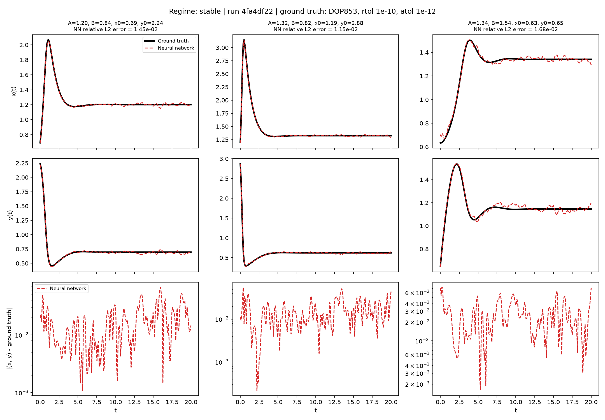
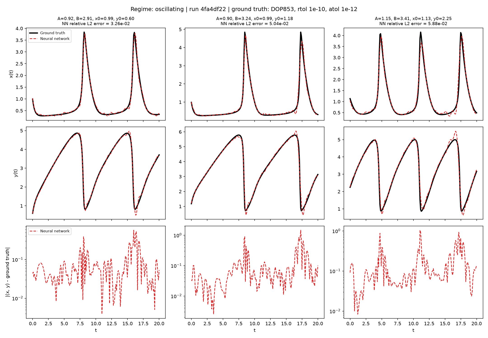
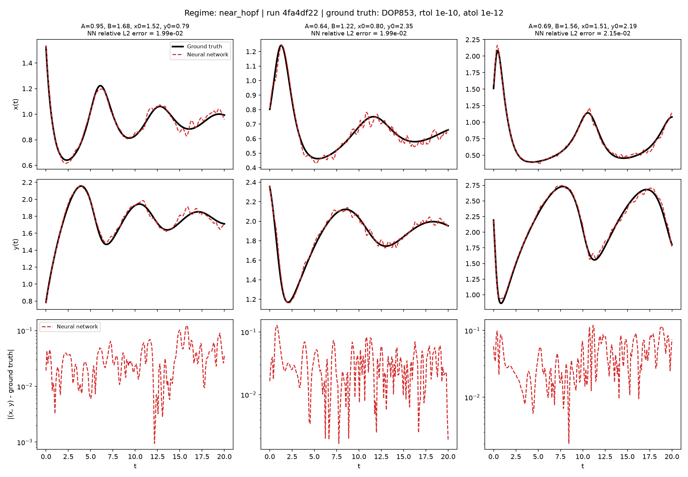
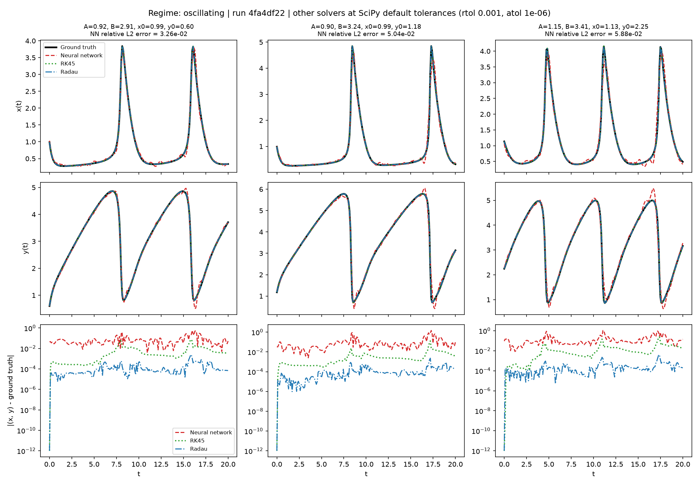

# Brusselator — Neural Network Surrogate Solver

A neural network trained to approximate solutions of the nonlinear Brusselator ODE system.
The project includes data generation using numerical Runge–Kutta integration, model training,
and a three-stage greedy hyperparameter tuning procedure.

---

## The Brusselator System

The [Brusselator](https://en.wikipedia.org/wiki/Brusselator) is a mathematical model of an autocatalytic chemical reaction:

$$
\begin{aligned}
A &\to X,\\
2X+Y &\to 3X,\\
B+X &\to Y+D,\\
X &\to E.
\end{aligned}
$$

The corresponding system of ordinary differential equations is

$$
\begin{aligned}
\frac{dx}{dt} &= A+x^2y-(B+1)x,\\
\frac{dy}{dt} &= Bx-x^2y,\\
x(0)&=x_0,\qquad y(0)=y_0,
\end{aligned}
$$

where $A,B>0$ are constant parameters, $x(t),y(t)$ describe the concentrations of the substances $X,Y$, and $x_0,y_0\geq 0$
are their initial concentrations. The system is nonlinear and exhibits a Hopf bifurcation at

$$
B_c=1+A^2.
$$

This separates the parameter plane into two qualitatively different dynamical regimes:

- **Stable regime:** For $B<1+A^2$, the unique fixed point
  $$
  (x^*,y^*)=\left(A,\frac{B}{A}\right)
  $$
  is asymptotically stable, and trajectories converge to it.
- **Oscillating regime:** For $B>1+A^2$, the fixed point becomes unstable and trajectories approach a stable limit cycle.

The network learns the parameter-to-solution map

$$
(A,B,x_0,y_0)\mapsto
\bigl(x(t_0),\ldots,x(t_{N_T-1}),
y(t_0),\ldots,y(t_{N_T-1})\bigr)
$$

over a fixed time grid with $N_T = 200$ grid points, and $T = 20.0$ the finite time horizon.

---

## Sample Plots





---

## Project Structure

- `src/config.py` — central configuration of parameters, data ranges, solver settings, and paths
- `src/ode.py` — Brusselator right-hand side, numerical solver, time grid, and regime classification
- `src/dataset.py` — saving and loading datasets and metadata
- `src/generate_data.py` — Sobol parameter sampling, numerical trajectory generation, and dataset splitting
- `src/metrics.py` — relative \(L^2\) error calculation and error summaries
- `src/train_neural_network.py` — model construction, training, and MLflow experiment logging
- `src/hyperparameter_tuning.py` — greedy, three-stage hyperparameter tuning
- `src/evaluate.py` — evaluation of trained models
- `tests/` — unit tests for the project modules
- `DATA/` — generated training, validation, and test datasets
- `mlflow.db` — local MLflow tracking database

---

## Approach

Training data is generated by sampling the parameter space using a scrambled Sobol sequence.
For each sampled parameter set, the corresponding ODE system is solved numerically using
SciPy's `solve_ivp` with a Runge–Kutta method.

The neural network is implemented using scikit-learn's `MLPRegressor`. Input and output data
are standardised using `StandardScaler`, and early stopping is used during training.

Model performance is evaluated using the relative \(L^2\) error between the predicted and reference trajectories.
Results are summarised both across the entire dataset and separately for the different dynamical regimes.

---

## Hyperparameter Tuning

Due to computational and hardware limitations, hyperparameter tuning follows a simple three-stage greedy approach.
Each stage uses the best configuration found in the previous stage as its starting point.

1. **Stage 1 — Network architecture:** Compare different network depths and widths to find the best hidden-layer architecture.
2. **Stage 2 — Learning rate and batch size:** Using the best architecture from Stage 1, compare different learning rates and batch sizes.
3. **Stage 3 — Activation and regularisation:** Using the best configuration from Stages 1 and 2, compare `tanh` and `relu` activation functions and different values of the regularisation parameter \(\alpha\).

The validation mean relative \(L^2\) error is used to select the best configuration. Models that achieve a new best score are logged and saved using MLflow.

---

## How to Run

Run the following commands from the project Brusselator/ directory.

**1 — Install dependencies**

```bash
pip install -r requirements.txt
```

**2 — Generate data**

```bash
python -m src.generate_data
```

Generates the training, validation, and test datasets in `data/`.

**3 — Train the network**

```bash
python -m src.train_neural_network
```

Trains the network using the default hyperparameters and logs the results to MLflow, model runs are saved in mlruns/.

**4 — Tune hyperparameters**

```bash
python -m src.hyperparameter_tuning
```

Runs the three-stage greedy hyperparameter search and logs the results to MLflow, the current best model runs are saved in mlruns/.

**5 — Evaluate a trained model**

```bash
python -m src.evaluate --run-id YOUR_RUN_ID
```

Loads a model from an MLflow run and evaluates its predictions against the numerical reference solutions.
The run_id can be found in the MLmodel file created inside the mlruns/ folder (e.g. run_id: 5fa4df22f16245afa137435654970780)

**Run tests**

```bash
pytest -v
```

Runs all unit tests in the `tests/` directory.

---

## Requirements

- Python 3.10 or newer
- NumPy
- SciPy
- scikit-learn
- Matplotlib
- MLflow
- skops
- pytest (development dependency)

Install all dependencies from the project root:

```bash
pip install -r requirements.txt
```

---

## License

This project is licensed under the [MIT License](../LICENSE).
