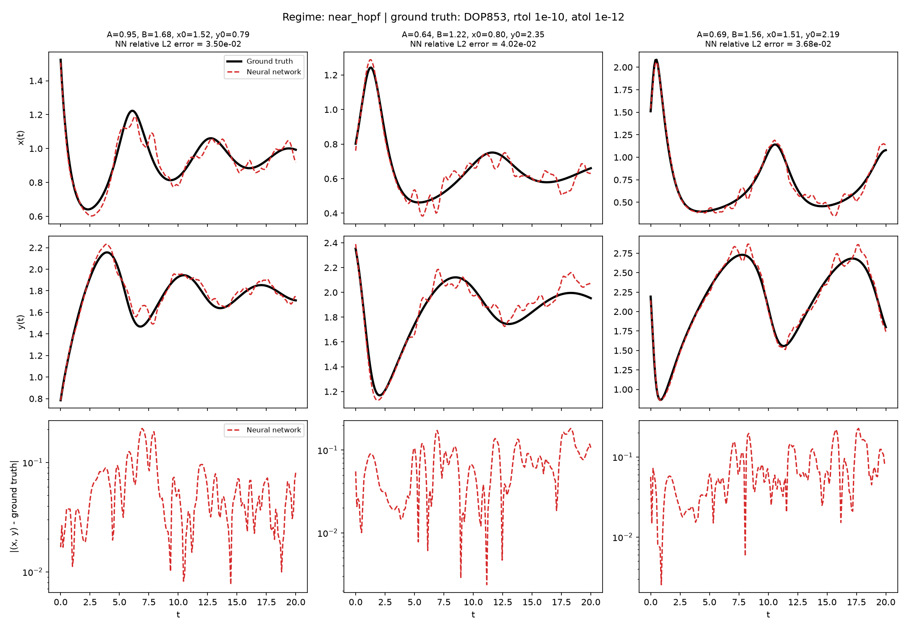
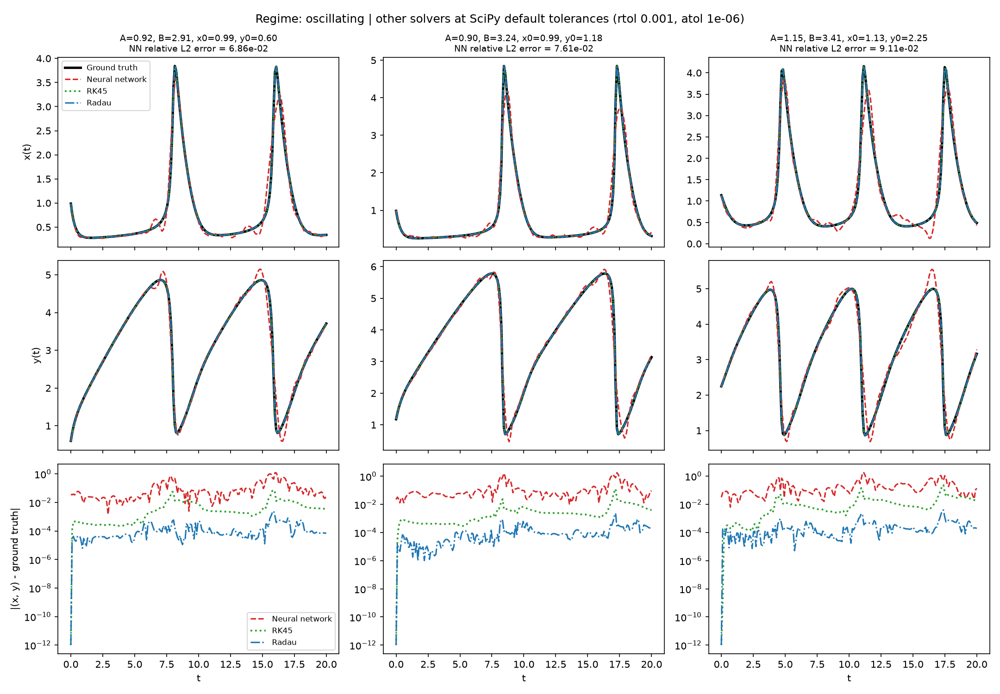

# Brusselator — Neural Network Solver

A from-scratch neural network trained to solve the normalised logistic ODE, replacing
repeated numerical integration with a single forward pass at evaluation time.

---

## The Brusselator System of Equations

The [Brusselator](https://en.wikipedia.org/wiki/Brusselator) is a system of two ordinary differential equations
that acts as a toy model for an autocatalytic reaction
$$
\begin{align*}
A&\to X\\
2X+Y&\to 3X\\
B+X&\to Y+D\\
X&\to E 
\end{align*}
$$

The ODE system is
$$
\begin{align*}
\frac{dx}{dt} &= A + x^2y - (B+1)x ,\\
\frac{dy}{dt} &= Bx - x^2y ,\\
x(0) = x_0,\quad& y(0) = y_0 ,
\end{align*}
$$
where $A,B>0$ are scalar constants (the concentration of the reactants $A,B$), $x(t),y(t)$ 
are the unknown scalar functions that describe the concentrations of the two intermediate species X and Y over time, 
and finally $x_0,y_0\geq0$ are the initial concentrations of X and Y.


From a mathematical and modelling perspective the above problem is challenging for one as it is a nonlinear equation, 
and for two since a Hopf bifurication appears at $B_c = 1 + A^2$, that means that the parameter plane (A,B) splits 
into two qualitatively different regimes, separated by the parabola $B = 1 + A^2$.
\begin{itemize}
\item For $B < 1 + A^2$ the unique fixed point $(x^*,y^*)=(A, B/A)$ is stable, and all trajectories spiral into it.
\item For $B > 1 + A^2$ the fixed point is unstable and the trajectories converge to a stable limit cycle.
\end{itemize}

## First results




<!---

[//]: # <> (This is a comment, it will not be included)
[//]: # <> The network learns the parameter-to-solution map $(u_0, r) \mapsto (u(t_0), \dots, u(t_{99}))$
[//]: # <> over a fixed time grid $t \in [0, 1]$ with 100 equally spaced points.

---

## Sample Plots

[comment]: <> 
[comment]: <> 

---

## Project Structure

[comment]: <> - `generate_data.py` — samples $(u_0, r)$ pairs, computes exact solutions, saves to CSV
[comment]: <> - `train_neural_network.py` — builds and trains the network, saves the trained model
[comment]: <> - `solve_ode.py` — loads the trained network and evaluates it on new parameter pairs
[comment]: <> - `neural_network.py` — self-contained NumPy implementation of the neural network
[comment]: <> - `DATA/` — generated training and test CSVs
[comment]: <> - `TRAINED_NN/` — saved model weights (`.npz`)
[comment]: <> - `PLOTS/` — loss curve and prediction plots produced during training
[comment]: <> - `sample_plots/` — example output plots for this README
[comment]: <>- `TESTS/` — unit tests for all modules

---

## Approach

[comment]: <> This implementation is adapted from the MNIST digit recognition framework described in:

[comment]: <> - [Neural Networks and Deep Learning](http://neuralnetworksanddeeplearning.com/) — Michael Nielsen
[comment]: <> - [Neural Networks playlist](https://www.youtube.com/watch?v=8bNIkfRJZpo) — Sebastian Lague

[comment]: <> The core network is a fully connected feedforward network trained with mini-batch SGD
[comment]: <> and backpropagation. Hidden layers use `tanh` or `sigmoid` activation; the output layer is linear,
[comment]: <> which is appropriate for a regression target. Weights are initialised with Xavier/Glorot scaling
[comment]: <> (1/sqrt(fan_in)) to keep activation variance stable across layers and avoid vanishing gradients,
[comment]: <> which is appropriate for tanh and sigmoid hidden units.

---

## How to Run

[comment]: <> **1 — Generate data**
[comment]: <> ```bash
[comment]: <> python generate_data.py
[comment]: <> ```
[comment]: <> Produces `DATA/training_data.csv` (10 000 samples) and `DATA/testing_data.csv` (1 024 samples).

[comment]: <> **2 — Train the network**
[comment]: <> ```bash
[comment]: <> python train_neural_network.py
[comment]: <> ```
[comment]: <> Trains the network and saves the model to `TRAINED_NN/trained_model_logistic_ode.npz`.
[comment]: <> Loss curve and prediction plots are saved to `PLOTS/`.

[comment]: <> **3 — Evaluate on new parameters**
[comment]: <> ```bash
[comment]: <> python solve_ode.py
[comment]: <> ```
[comment]: <> Loads the trained model and evaluates it on a set of $(u_0, r)$ pairs, comparing the
[comment]: <> network output to the exact solution. Similar to prediction an evaluation plot is
[comment]: <> saved to `PLOTS/`.

[comment]: <> **Run tests**

[comment]: <> Move to TESTS folder and run the commands
[comment]: <> ```bash
[comment]: <> python generate_data_tests.py
[comment]: <> python neural_network_tests.py
[comment]: <> python train_neural_network_tests.py
[comment]: <> python solve_ode_tests.py
[comment]: <> ```

---

## Requirements

[comment]: <> - Python 3.x
[comment]: <> - numpy 1.21.5
[comment]: <> - pandas 2.0.0
[comment]: <> - matplotlib 3.5.1
[comment]: <> +++++++

[comment]: <> ```bash
[comment]: <> pip install numpy pandas matplotlib
[comment]: <> ```

---

## License

This project is licensed under the [MIT License](../LICENSE).

-->
